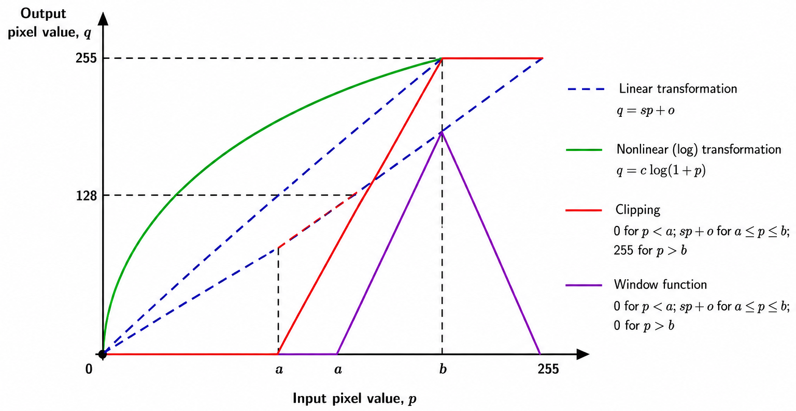

Point operations are basic image processing techniques in which the value of each output pixel is determined directly from the corresponding pixel value in the input image. Since each pixel is processed independently, point operations can be used to modify the intensity or gray level of an image without considering the values of neighbouring pixels.

Point operations are commonly used to change the visual appearance of an image, for example, by improving contrast, changing the range of gray levels, or emphasizing particular intensity ranges. They are useful in applications such as medical imaging, remote sensing, and image display, where the original image may not provide sufficient visual distinction between important regions.

In the **Point Operations experiment**, different transformation functions are applied to the pixel values of a grayscale image. By changing the transformation function, the same input image can produce different output appearances.

### Pixel Value Transformation

Let $f(x,y)$ represent the input image and $g(x,y)$ represent the output image at pixel location $(x,y)$. If the input pixel value at $(x,y)$ is $p$ and the corresponding output pixel value is $q$, then a point operation can be represented as

$$
q = T(p)
$$

where $T$ is the transformation function that maps the input pixel value $p$ to the output pixel value $q$.

The important feature of a point operation is that the output value depends only on the corresponding input pixel value. The values of neighbouring pixels do not directly affect the transformation.

For an 8-bit grayscale image, the pixel values normally lie in the range

$$
0 \leq p \leq 255
$$

The transformation is therefore applied so that the resulting output values can be represented within the valid grayscale range.

The effect of a point operation depends mainly on the shape and parameters of the transformation function $T$. In this experiment, four basic types of transformation functions are studied:

1. Linear function
2. Nonlinear function
3. Clipping
4. Window function

#### Interpretation

The graph illustrates how different point operation transformation functions map an input pixel value p to an output pixel value q. The horizontal axis represents the input pixel value, while the vertical axis represents the corresponding output pixel value.

The shape of the transformation function determines how different gray levels are modified. A linear transformation changes pixel values according to a straight-line relationship, whereas a nonlinear transformation changes different gray-level ranges by different amounts. The clipping and window functions treat a selected range of input pixel values differently from values outside that range.

Therefore, changing the transformation function or its parameters changes the mapping between input and output pixel values and consequently changes the appearance of the output image.

### Linear Function

In a linear point operation, the output pixel value is linearly related to the input pixel value. A simple linear transformation is given by

$$
q = sp + o
$$

where $s$ is the slope of the transformation and $o$ is the offset.

The slope determines how strongly the input gray levels are stretched or compressed. The offset shifts the resulting gray levels toward higher or lower values.

For example, when the slope is increased, differences between pixel values can become more pronounced, which can improve the visibility of details over a particular intensity range. A suitable offset can then be used to shift the resulting gray levels to the desired range.

Thus, a linear transformation can be used to modify the brightness and contrast of a grayscale image.

### Nonlinear Function

In a nonlinear point operation, the relationship between the input and output pixel values is not a straight-line relationship. Different ranges of input gray levels can therefore be expanded or compressed by different amounts.

One commonly used nonlinear transformation is the logarithmic transformation:

$$
q = c\log(1+p)
$$

where $c$ is a constant.

The logarithmic function changes low and high gray-level values by different amounts. In particular, it can expand a narrow range of low-intensity values while compressing higher-intensity values. This can make details present in darker regions of an image more visible.

The effect of a nonlinear transformation therefore depends on the selected transformation function and its parameters.

### Clipping

Clipping is a piecewise point transformation in which different rules are applied to different ranges of input pixel values. In the form used in this experiment, the output is set to a lower value for pixels below a selected range, transformed using a linear function within the selected range, and set to an upper value for pixels above that range.

The transformation can be expressed as

$$
q =
\begin{cases}
0, & p < a \
sp + o, & a \leq p \leq b \
L, & p > b
\end{cases}
$$

where $a$ and $b$ define the input gray-level range over which the linear transformation is applied, $s$ is the slope, $o$ is the offset, and $L$ is the maximum allowed output gray level.

For an 8-bit grayscale image,

$$
L = 255
$$

Therefore, pixel values below the selected range are mapped to the lower output level, values within the selected range are transformed according to the linear function, and values above the selected range are mapped to the upper output level.

In this experiment, the offset is kept fixed at zero for the clipping transformation.

Clipping is useful when a particular range of gray levels needs to be enhanced while values outside that range are restricted to the lower or upper limit.

### Window Function

The window function is similar to clipping because it also focuses on a selected range of input gray levels. However, values outside the selected range are mapped to the lower output level rather than to the upper level.

The transformation used for the window function can be written as

$$
q =
\begin{cases}
0, & p < a \
sp + o, & a \leq p \leq b \
0, & p > b
\end{cases}
$$

where $a$ and $b$ define the selected input gray-level range, $s$ is the slope, and $o$ is the offset.

As a result, only the selected range of input gray levels contributes to the corresponding nonzero output values. Pixel values below and above the selected range are suppressed.

This type of transformation can be useful when a particular range of gray levels contains the image information that needs to be emphasized.

### Effect of Point Operations on an Image

The same input image can produce substantially different results depending on the selected point transformation. A linear transformation can change the brightness or contrast of an image, while a nonlinear transformation can expand or compress selected intensity ranges.

Clipping and window functions allow a specific range of gray levels to be treated differently from the rest of the image. Therefore, selecting suitable transformation parameters is important because the parameters determine which pixel values are emphasized, compressed, or suppressed.

Since point operations process pixels independently, the transformation does not depend on the spatial arrangement of neighbouring pixels. This distinguishes point operations from neighbourhood-based image processing techniques, where the output value depends on a group of nearby pixels.

### What to Observe in the Point Operations Experiment

In this experiment, observe how changing the transformation type and its parameters changes the appearance of the output grayscale image.

In particular, observe:

- how a linear transformation changes the brightness and contrast of the image;
- how a nonlinear transformation changes different gray-level ranges by different amounts;
- how clipping treats pixel values below, within, and above a selected range; and
- how the window function preserves a selected gray-level range while suppressing values outside that range.

These observations help demonstrate the relationship between the transformation function $T$ and the resulting pixel values.

The key idea of the **Point Operations experiment** is that an image can be enhanced or modified by applying an appropriate transformation directly to its pixel values. Understanding how different transformation functions map input gray levels to output gray levels makes it possible to predict and interpret the resulting changes in the image.
